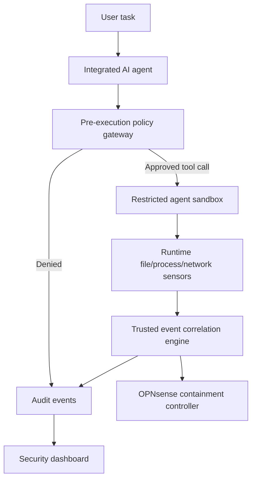

# Aegyntra proposed architecture

**v0.1 implemented:** policy checks, event logging, decoy signals, simulation API and tests.

**Future:** actual agent adapter, credential broker, sandbox OS enforcement, firewall integration, telemetry correlation and dashboard. Tool calls cannot reveal private model reasoning; pre-execution control requires mediation of the real execution path.
